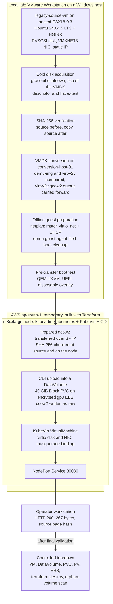

# VM-to-Kubernetes Migration Platform — VMware ESXi to KubeVirt

An engineering portfolio project that migrates a Linux virtual machine from VMware ESXi to KubeVirt on Kubernetes. It covers the whole path: VMware source build, cold disk acquisition, integrity verification, VMDK conversion, offline guest preparation, a Terraform-built AWS target, CDI disk import, KubeVirt VM deployment and end-to-end application validation, followed by a verified teardown.

| Item | Value |
|---|---|
| Status | **Stage 1I complete (1 October 2026).** The first end-to-end cold migration was executed and validated |
| Source | Nested VMware ESXi 8.0.3 under VMware Workstation; `legacy-source-vm`, Ubuntu 24.04.5 LTS serving a fixed NGINX page |
| Destination (temporary) | Self-managed, single-node Kubernetes cluster bootstrapped with kubeadm on one AWS EC2 instance with nested virtualization, running KubeVirt and CDI. **Not Amazon EKS** |
| Migration type | Cold migration of one VM. The source was shut down for about 10.5 minutes to copy its disk (Stage 1E), then restarted. No application cutover to the migrated copy was performed |
| Result | The migrated VM ran on KubeVirt and served the source page over HTTP (status 200, 267 bytes, matching the source content hash) |
| Destination today | **Destroyed.** The migrated VM, its storage and all Terraform-managed AWS resources were removed after validation, and the removal was verified in AWS |

## What this project demonstrates

- **VMware virtualization:** nested ESXi build, VM hardware baseline (PVSCSI, VMXNET3, UEFI), datastore and VMDK anatomy, cold acquisition from a free ESXi host.
- **Linux image conversion:** `qemu-img` and `virt-v2v` conversion, libguestfs offline inspection and editing, QEMU/KVM boot validation with UEFI and virtio.
- **Kubernetes and KubeVirt:** kubeadm, CRI-O, flannel, KubeVirt, CDI DataVolumes, the AWS EBS CSI driver, masquerade networking and NodePort exposure.
- **Infrastructure as code:** Terraform for the disposable AWS target (VPC, security group, IAM instance profile, EC2 node), with a reviewed destroy plan.
- **Data integrity and validation:** SHA-256 verification of every file copy and of each derived disk image, protected (read-only, immutable) artifacts, guest-level identity and content checks after the CDI import, and evidence labelled as observed, inferred or not tested.

## Architecture

Supporting diagrams: [migration pipeline](docs/diagrams/stage-1i-visual/02-pipeline.svg), [infrastructure](docs/diagrams/stage-1i-visual/03-infrastructure.svg), [HTTP packet path](docs/diagrams/stage-1i-visual/07-packet-path.svg), [storage lifecycle](docs/diagrams/stage-1i-visual/08-storage-lifecycle.svg) and [evidence dashboard](docs/diagrams/stage-1i-visual/11-evidence-dashboard.svg). The Stage 1H design views are the [target platform](docs/diagrams/stage-1h-target-platform.svg), [migration data path](docs/diagrams/stage-1h-migration-data-path.svg) and [network model](docs/diagrams/stage-1h-network-model.svg).

## Verified target platform

Values as observed during Stage 1I (recorded in [section 16 of the Stage 1I record](docs/stage-1/stage-1i-first-kubevirt-migration.md#16-gate-i3-aws-destination-platform)). The design rationale is in [ADR 007](docs/adr/007-kubevirt-target-platform.md).

| Layer | Value |
|---|---|
| Region / AZ | `ap-south-1` / `ap-south-1a` |
| Instance | `m8i.xlarge` (4 vCPU, 16 GiB), nested virtualization enabled, on demand |
| Node OS | CentOS Stream 9 x86_64, SELinux enforcing |
| Kubernetes | v1.36.5, installed with kubeadm; one node acting as control plane and worker |
| Container runtime | CRI-O 1.36.6 |
| CNI | flannel v0.28.9 |
| KubeVirt / CDI | v1.9.0 / v1.66.1 |
| Storage | AWS EBS CSI driver with the `ebs-gp3-encrypted` StorageClass (gp3, encrypted, Block mode for the VM disk) |
| Infrastructure as code | Terraform: 10 AWS resources (VPC, subnet, internet gateway, route table and association, security group, IAM role, policy attachment and instance profile, EC2 instance) |
| Exposure | Security group allows TCP 22 and TCP 30080 from the operator's /32 only. The Kubernetes API and the CDI upload proxy were not exposed publicly |
| Migrated workload | Ubuntu 24.04.5 LTS with NGINX 1.24.0 |

This was a single-node target for a controlled cold-migration proof of concept, not a highly available production cluster.

## Migration Results and Validation

All results below are recorded as observed in the [Stage 1I execution record](docs/stage-1/stage-1i-first-kubevirt-migration.md). Stage 1I ran as five approval gates (I1 to I5), and all five passed.

| Step | Recorded result |
|---|---|
| Cold acquisition (Stage 1E) | The VMDK flat extent hashed identically on the source before the copy, on the copy and on the source after the copy. The source VM was not modified; acquisition required a graceful shutdown with about 10.5 minutes of service downtime |
| Guest preparation (Gate I1) | New standalone qcow2 from the virt-v2v output: netplan matches the `virtio_net` driver with DHCP, `qemu-guest-agent` installed offline, virt-v2v first-boot scripts removed. 41 of 41 integrity checks passed; the image was hashed and made read-only and immutable |
| Pre-transfer boot (Gate I2) | The prepared image booted under QEMU/KVM with UEFI, obtained a DHCP lease and served the source page (54 of 54 checks) |
| Transfer and import (Gate I4) | The prepared qcow2's SHA-256 was verified on the conversion host before and after the transfer. On the node, the same hash was recorded immediately before the CDI upload and again before the temporary file was deleted. The original post-transfer check log was lost, as disclosed below. CDI imported the image into a standalone DataVolume backed by a 40 GiB encrypted gp3 EBS volume. CDI writes raw, so the imported disk was verified by guest-level checks rather than by a file hash |
| VM runtime (Gate I4) | VM `Running` and `Ready`; the QEMU guest agent connected; 36 of 36 guest boot and network checks passed |
| Application (Gates I4 and I5) | From the operator workstation through NodePort 30080: HTTP `200`, 267 bytes, SHA-256 matching the source page |
| Guest identity | Hostname, machine-id, filesystem UUIDs, SSH host keys and the NGINX configuration tree identical to the source baseline |
| Source VM | Disk content unchanged by acquisition (hash-verified). Restarted after the Stage 1E copy, not contacted during Stage 1I, and still serving the same 267-byte page when checked after teardown |
| Teardown (Gate I5) | VM and Service deleted; deleting the DataVolume removed the PVC, PV and EBS volume through their normal lifecycle; `terraform destroy` removed exactly 10 resources; AWS lookups confirmed removal |
| Cleanup verification | The orphan-volume scan found no remaining migration volume, and the temporary Stage 1I credentials and access paths were removed |

Expected platform differences after migration were recorded rather than hidden: the NIC changed from `ens192` (VMXNET3) to `enp1s0` (virtio), the disk from PVSCSI `sda` to virtio `vda`, and the static address 192.168.50.31 became 10.0.2.2 by DHCP inside the KubeVirt pod. Service continuity was proven by content, not by IP address ([ADR 008](docs/adr/008-kubevirt-network-model.md)).

Engineering practices visible in the records:

- **Protected inputs.** The golden VMDK copy and the conversion working copy were only ever read. Each derived image (the Stage 1G conversions and the Stage 1I prepared qcow2) was hashed and made read-only before the next step used it.
- **Guest network remediation.** Stage 1G showed that the converted guest booted without a network because netplan matched `ens192`. The fix ([ADR 010](docs/adr/010-migration-network-remediation.md)) matches by driver and uses DHCP, and was applied offline to a disposable copy.
- **Least exposure.** The node's IAM role holds only the EBS CSI policy, IMDSv2 is required, volumes are encrypted, and the cluster was managed through an SSH tunnel rather than a public API endpoint.
- **Lifecycle-owned deletion.** The VM disk was removed through its DataVolume, not by deleting volumes directly, and AWS resources only through the Terraform state that created them.
- **Honest evidence.** The original post-transfer destination-hash log was accidentally deleted during evidence assembly. The record says so and relies on two surviving original records of the same hash, rather than reconstructing the lost one.

## Scope and Limitations

- This is an independent engineering portfolio project and proof of concept, not a production customer deployment.
- The implemented migration is a **cold migration of a single VM**. Live migration, warm migration, high availability and multi-node destination behaviour were not demonstrated. The migrated VM's disk is ReadWriteOnce, and KubeVirt reported it as not live-migratable.
- The migration was a point-in-time copy of the disk taken during the Stage 1E cold acquisition, which required about 10.5 minutes of source downtime. No application cutover was performed: the source VM kept its IP address and continued serving after it was restarted, and clients were never moved to the migrated copy.
- The target was a single node. It was temporary and was destroyed after validation.
- The project does not establish a tested, production-ready migration service for arbitrary VMware workloads.
- **Forklift (MTV) was not used.** The workflow was executed step by step under explicit approval gates.
- **No custom controller or CRD is implemented.** [ADR 005](docs/adr/005-custom-controller-vs-scripts.md) chooses a controller-driven design for a later stage, and Stage 0 documents the intended CRD and state machine; the repository contains no controller code or CRD manifests.
- Terraform covers the AWS layer. Kubernetes, KubeVirt, CDI and the CSI driver were installed on the node from upstream release manifests, as recorded in the Stage 1I record; the helper scripts used for that are not in this repository, so the target is not a one-command rebuild.
- Amazon EKS was investigated and deferred in [ADR 007](docs/adr/007-kubevirt-target-platform.md); it was not tested.
- Raw evidence files are kept outside the repository. The stage records summarise them, with file hashes.

Possible future work, **not implemented**: the controller-driven migration workflow of ADR 005, migration of additional or different workloads, an EKS comparison, and warm-migration study ([ADR 003](docs/adr/003-cold-before-warm.md) keeps warm migration as study and reference work).

## Documentation

| Topic | Link |
|---|---|
| Stage 1I migration execution record (gates I1 to I5) | [docs/stage-1/stage-1i-first-kubevirt-migration.md](docs/stage-1/stage-1i-first-kubevirt-migration.md) |
| Runtime learning snapshot of the running VM (read-only, taken before teardown) | [docs/stage-1/stage-1i-runtime-snapshot.md](docs/stage-1/stage-1i-runtime-snapshot.md) |
| Stage 1 index (source build-out through Stage 1I) | [docs/stage-1/README.md](docs/stage-1/README.md) |
| Stage 0 (theory, architecture, feasibility) | [docs/stage-0/README.md](docs/stage-0/README.md) |
| Architecture decision records | [docs/adr/README.md](docs/adr/README.md) |
| Diagrams | [docs/diagrams/](docs/diagrams/) (Stage 1I set in [docs/diagrams/stage-1i-visual/](docs/diagrams/stage-1i-visual/)) |
| Terraform for the AWS target | [infra/terraform/stage-1i-target/](infra/terraform/stage-1i-target/) |
| Kubernetes manifests | [VirtualMachine](infra/kubernetes/stage-1i/vm-legacy-source-vm-migrated.yaml), [DataVolume](infra/kubernetes/stage-1i/datavolume-legacy-source-vm-disk.yaml), [HTTP Service](infra/kubernetes/stage-1i/service-legacy-source-vm-http.yaml), [StorageClass](infra/kubernetes/stage-1i/storageclass-ebs-gp3-encrypted.yaml), [kubeadm config template](infra/kubernetes/stage-1i/kubeadm-config.yaml.tmpl) |
| Visual learning pages (HTML) | [Stage 1I visual](docs/stage-1/stage-1i-visual-learning.html), [learning portal](docs/index.html) |
| Project status and next steps | [docs/project-context/project-status-and-next-steps.md](docs/project-context/project-status-and-next-steps.md) |
| Original context handoff (historical, 2026-09-27) | [docs/project-context/project1-5-context-handoff.md](docs/project-context/project1-5-context-handoff.md) |

## Stage summary

| Stage | Outcome | Status |
|---|---|---|
| 0 | Theory, architecture, feasibility, ADRs 001 to 005 | Complete |
| 1A to 1C | ESXi host validated; KVM/QEMU fundamentals; migration source VM built and baselined | Complete |
| 1D to 1E | Source VMDK characterised; cold acquisition with SHA-256 verification | Complete |
| 1F to 1G | Dedicated conversion host; qemu-img and virt-v2v conversion; QEMU/KVM boot validation; network failure found and remediated on a disposable copy | Complete |
| 1H | KubeVirt target, network and storage design (ADRs 007 to 010); nothing provisioned in this stage | Design complete (H1 to H10 PASS) |
| 1I | Prepared image, boot test, AWS target, first migration, final validation and teardown | **Complete, 1 October 2026** |
